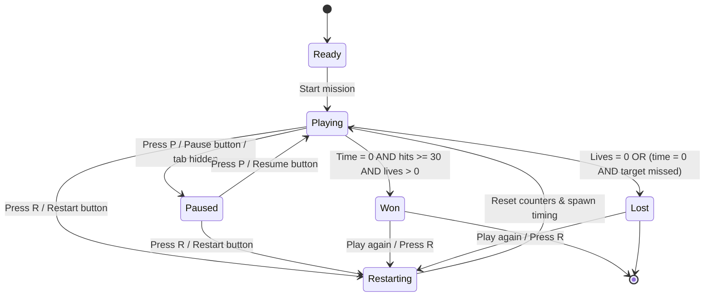
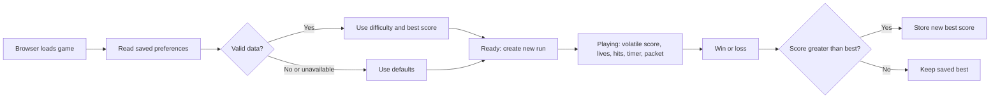

# Game State Diagram — Packet Pulse V2

## Transition table

| From | Trigger | To | Behavior |
| --- | --- | --- | --- |
| `ready` | Start | `playing` | Fresh run starts, all counters initialized |
| `playing` | Pause / tab hidden | `paused` | Time and packet motion frozen |
| `paused` | Resume | `playing` | Frame timestamp reset to prevent time jump |
| `playing` | Timer ends, >=30 hits and lives >0 | `won` | End overlay; update personal best if higher |
| `playing` | Lives reach 0 OR timeout without target | `lost` | End overlay; update personal best if higher |
| `playing` / `paused` / `won` / `lost` | Restart | `restarting` | Clear packet, reset runtime variables |
| `restarting` | Reset completes | `playing` | Fresh mission begins immediately |

`restarting` is an intentional, immediate transition state (it does not render as a separate overlay). Invalid edges such as `ready → paused`, `won → playing` without restart, or scoring while paused are blocked.

## Persistence boundary

## Constants

- Match target: **30**; play duration: **180 s**.
- Level step: **8 correct packets**; max level: **5**.
- Speeds: Easy 160, Normal 205, Hard 250 pixels/s at level 1; add 28 pixels/s per level.
- Correct: **+10 score**. Wrong: **-1 life**, streak reset.
- Saved key: `packet-pulse-v2-prefs` → `{ "difficulty": "normal", "bestScore": 0 }`.
